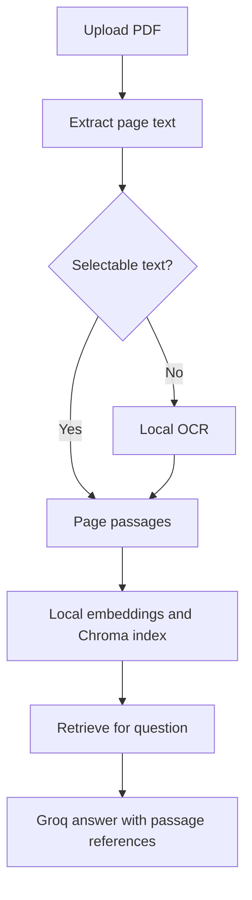

# Document Q&A Assistant

A Python/Streamlit retrieval-augmented generation (RAG) app for asking questions about an uploaded PDF. It reads searchable PDFs directly, applies OCR to image-only pages, retrieves relevant passages, and asks a Groq-hosted language model to answer with page-backed references.

## What it does

- Upload one PDF (up to 10 MB) and ask questions in a chat interface.
- Extract selectable text with PyMuPDF; use local RapidOCR for pages without selectable text.
- Split text into overlapping passages while keeping each passage's page number.
- Embed passages locally with `sentence-transformers/all-MiniLM-L6-v2` and search them in an in-memory Chroma collection.
- Send the retrieved passages to Groq (`openai/gpt-oss-120b` by default) for an answer grounded in the document.
- Use recent conversation to interpret follow-up questions; reset chat when a different PDF is uploaded.
- Show retrieved passages and page numbers for review. Normalize common citation styles to `[1]` and withhold answers with references that do not match retrieved passage numbers.

## Technology

| Part | Technology |
| --- | --- |
| Interface | Python, Streamlit |
| PDF text and page rendering | PyMuPDF |
| Scanned-page OCR | RapidOCR, ONNX Runtime (local CPU) |
| Text embeddings | Sentence Transformers, `all-MiniLM-L6-v2` |
| Vector search | ChromaDB (in memory) |
| Answer generation | Groq API, configurable model |
| Local configuration | `python-dotenv`, `.env` |

## How it works



OCR and embeddings run locally. The retrieved passage text and question are sent to Groq to generate the answer. The entire PDF is not sent as a file by this code.

## Run locally on Windows

Use Python 3.11 or 3.12. In PowerShell, open the folder containing `app.py` and `requirements.txt`:

```powershell
py -3.12 -m venv .venv
.\.venv\Scripts\python.exe -m pip install --upgrade pip
.\.venv\Scripts\python.exe -m pip install -r requirements.txt
Copy-Item .env.example .env
notepad .env
```

In `.env`, replace the example value with a new Groq API key. Keep the key private. The optional `GROQ_MODEL` line selects a model available to your Groq account. Start the app:

```powershell
.\.venv\Scripts\python.exe -m streamlit run app.py
```

Open the local URL printed in the terminal. The first run can download embedding and OCR model weights. For a quick check, use a nonprivate PDF with known facts: ask a direct question, a follow-up question, and a question the document cannot answer. Expand **Retrieved passages** to compare the response with the source.

## Files

- `app.py`: Streamlit upload, chat state, `.env` loading, and results display.
- `rag.py`: extraction/OCR, chunking, embeddings, retrieval, Groq request, and citation checks.
- `requirements.txt`: Python dependencies.
- `.env.example`: configuration template; copy to `.env` locally.
- `.gitignore`: excludes local secrets and generated files.

## Privacy and limitations

- Do not commit `.env`, private PDFs, or screenshots containing personal information. Use a fictional or public PDF for a GitHub demo.
- OCR quality depends on scan clarity. The default OCR model is best suited to English; Arabic text may need a different OCR model.
- One PDF is indexed per browser session. The index is in memory and rebuilds after a restart or a different upload.
- Page references identify retrieved passages, but do not prove every model-generated statement is correct. Verify important answers against the displayed text.
- Citation numbers are assigned for each answer and can change with the next question. Invalid citations are withheld, but this is not a full factual verification system.

This project grew from a PDF → embeddings → Chroma → Groq course notebook into a runnable Streamlit application with local OCR, chat context, and source inspection.
